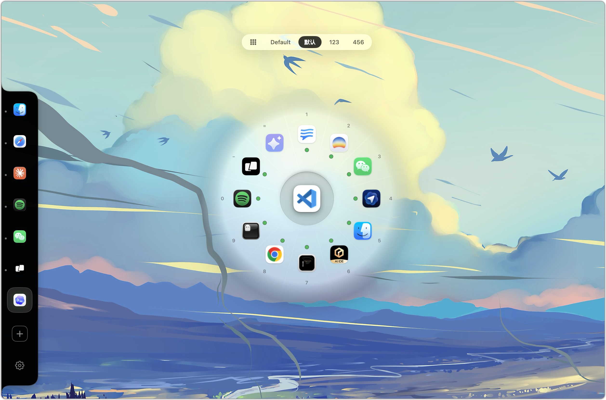
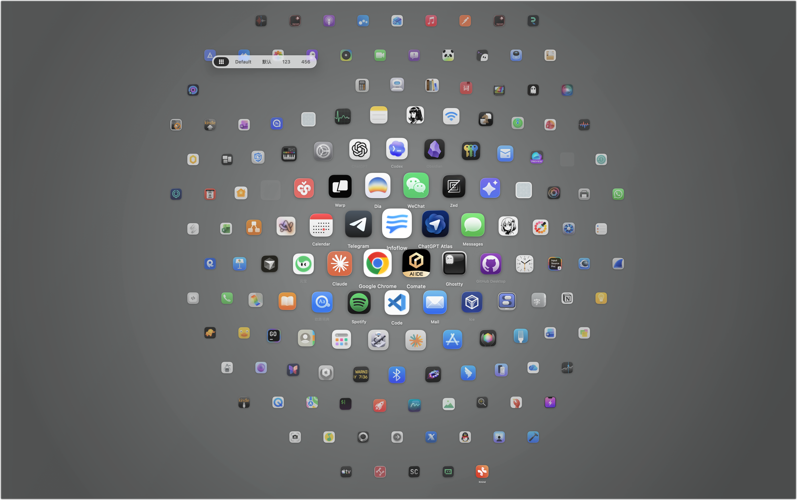

# Halo

一款 macOS 上的环形启动器，灵感源自解谜游戏《Hue》的色环机制。一个手势在常用应用间切换：按下热键，指向方向，松开。

单一、自包含的 macOS 应用。**核心切换流程不需要辅助功能（Accessibility）权限**。

[English README](README.md) · [CHANGELOG](CHANGELOG.md)




## 状态

**v1.1.2**（2026-05-15）—— Action Arc（按 ⇧ 或右键弹出四片 chip：Quit / Fullscreen / Hide / Custom）；多 profile pin 集合（顶部 pill bar 切换）；设置面板重建为 `NavigationSplitView`；白名单标签；面板缩放（0.80–1.50×）；滚轮切换槽位；macOS 26 完整 Liquid Glass。

v1.1.2 之后在 `main` 上的更新：watchOS 风格的 ALL 网格（见下文 [使用](#使用)）、`panelScale` 现在覆盖 ALL 网格、`OSSignposter` 性能埋点、图标 NSCache + 网格预热、pan/zoom 期间挂起 shadow。

## 安装

需要 **macOS 13（Ventura）及以上**。通用二进制（Apple Silicon + Intel）。Liquid Glass 表面在 macOS 26（Tahoe）点亮，更早的 macOS 自动回退到 `NSVisualEffectView`，视觉配方保持一致。

```sh
make install           # release 构建 + ad-hoc 签名 + 拷贝到 /Applications
open /Applications/Halo.app
```

或构建可分发的 zip：

```sh
make dist              # 产出 dist/Halo-vX.Y.Z.zip（版本号取自 Info.plist）
```

## 使用

### 轮盘（layer 1）

1. 按 **`⌘ ⌥ Space`**（或双击你配置的辅助键 —— ⌥左 / ⌥右 / ⌘ / ⌃ / 鼠标中键）。
2. 移动光标 —— 或按方向键 / 数字键 —— 高亮目标槽位。
3. 松开热键 —— 或点击 / 按 `Return` —— 完成切换。`ESC` 取消。

最常用的 **N** 个槽位（4 / 6 / 8 / 10 / 12）由过去 7 天激活次数最多的应用填充。频率模型（仅 MFU / 平衡 / 仅 MRU）在「设置」中可调。在「设置 → Apps」可将特定应用钉到槽位或覆写其身份色。

### Action Arc（layer 2）

轮盘召唤期间按 **⇧** 或点右键，会在光标所在槽位周围扇出四片 chip：**Quit · Fullscreen · Hide · Custom**。光标悬到目标 chip 上松开触发键即执行；点别处取消。Custom chip 是单 app 的自定义动作（键盘快捷键、Run Shortcut 或 AppleScript），在「设置 → Actions」中编辑。

Fullscreen / 键盘快捷键 chip 需要辅助功能权限，未授权时 chip 会变暗并显示黄色提示。Halo 其它路径仍然不需要辅助功能。

### ALL 网格（layer 0）

watchOS 风格的全屏蜂窝网格，把全部安装的应用平铺出来 —— 用于轮盘 top-N 不够时。

- **进入** —— 在轮盘召唤期间按 Tab 切到 ALL profile，或直接点击轮盘顶部那个蜂窝图标 pill。
- **搜索** —— 直接打字，按 name + bundle ID 做子串匹配；命中图标会被 fisheye 拉到中心附近。
- **导航** —— 光标悬停原地选中；方向键在相邻 cell 间步进，并把选中的应用移到中间。
- **启动** —— `Return` / `Space` / 点击；松开召唤键后 ALL 保持打开。
- **平移** —— 滚动（触控板或鼠标滚轮）或拖动。蜂窝在边界处橡皮筋回弹，松手后短促惯性滑行，再自动对齐，把最近的应用移到中间并选中。
- **取消** —— `ESC`。

应用按使用频率排序（最常用的在中心）。蜂窝通过一个透镜呈现，移植自 [onevra](https://github.com/oneo-me/onevra) 的 `honeycomb.go`（MIT）：图标离中心越远越小，范围是与屏幕比例一致的椭圆，像贴在球面上一样轻微倾斜，并向边缘淡出。停在 Bar 下面的应用会在蜂窝静止后让开。倾角、椭圆和边缘透明度可在「设置 → 通用 → 外观 → ALL 网格」调整；ALL pill 在「设置 → Apps → Show ALL profile」开关。

### 菜单栏

点击菜单栏图标可不用键盘召唤、切换 profile、打开设置。

## 设置（菜单栏 → 设置…）

五个标签，原生侧栏布局。默认 880 × 720，最小 760 × 600，可缩放。

- **通用** —— 槽位数量、召唤位置、频率模型、主热键、双击辅助键、滚轮切换、数字键提交、召唤时高亮当前应用、ALL profile 开关、面板大小、语言、自启、导出日志。
- **Apps** —— 用绑定轮盘把应用钉到槽位；每个槽位弹窗内可改身份色或取消 pin。顶部 pill bar 在多个 **profile**（独立 pin 集合，其它设置共享）之间切换。
- **Actions** —— 配置 Action Arc 的 Custom chip（键盘快捷键 / Run Shortcut / AppleScript）。
- **白名单** —— 在指定 bundle ID 内屏蔽 Halo 触发（IDE、设计工具、远程桌面、游戏）。「应用推荐」按系统中实际安装的应用过滤。
- **关于** —— 版本号、GitHub / 许可证链接、运行时元数据、内嵌日志导出。

规格文档：[产品设计](docs/PRODUCT.md) · [交互规格](docs/INTERACTION.md) · [视觉规格](docs/VISUAL.md) · [设置规格](docs/SETTING.md)。主要工作语言是中文。

## 开发

```sh
make build             # debug 构建
make test              # 单元测试（HaloCoreTests + HaloUITests）
make app               # 产出 dist/Halo.app（release，ad-hoc 签名）
make clean             # 清除 .build 和 dist
```

## 项目结构

```
Sources/HaloCore        无 UI 内核：engine、usage、OKLCH、prefs、profiles、actions、perf signpost
Sources/HaloUI          SwiftUI 视图 + Carbon 热键 + DoubleTapMonitor + 网格 + arc + NSPanel
Sources/HaloApp         AppDelegate、设置窗口、各标签、Pin 选择器、LaunchAgent
Tests/Halo{Core,UI}Tests  纯逻辑 + 视图层几何 / 状态测试
Resources/              Info.plist、*.lproj/Localizable.strings（en + zh-Hans）、Halo.icns
scripts/                build-app.sh、render-icon.swift
docs/                   产品 / 交互 / 视觉 / 设置规格（中文）
```

## 权限

Halo 核心切换 **不需要辅助功能权限**。两条触发路径都是被动状态查询：Carbon `RegisterEventHotKey` 主热键；`CGEventSource.keyState` + `NSEvent.pressedMouseButtons` 轮询双击辅助键。激活追踪走 `NSWorkspace` 通知。无 event tap、不读辅助功能树、无输入监控。

仅当你触发了需要权限的 Action Arc chip（Fullscreen toggle、自定义键盘快捷键）时才会请求辅助功能。未授权时 chip 会变暗显示黄色提示。触发变暗的 chip 会打开「系统设置 → 隐私与安全性 → 辅助功能」，并在窗口旁浮出一个跟随窗口的小面板——把面板里的 Halo 拖进列表即可授权。该引导由 [PermissionFlow](https://github.com/jaywcjlove/PermissionFlow) 提供。

## 数据与隐私

Halo **完全在本地运行**。无网络请求、无遥测、无分析。「设置 → 通用 → 导出诊断日志…」是唯一会暴露本地数据的入口，且也只是把文件写到 `~/Downloads/`，由你自己决定是否分享。

存了什么：`com.halo.launcher` 下的 user defaults（槽位配置、热键、pin、覆写、profile、Custom 动作、7 天使用日志）、`~/Library/Logs/Halo/` 下的文本活动日志、启用自启时的 LaunchAgent plist。日志包含切换过的应用 bundle ID —— 不含应用内容、按键、窗口标题、截图。

完整存储清单、重置与卸载脚本、perf 埋点 env：[docs/STORAGE.md](docs/STORAGE.md)。

## 许可

MIT —— 见 [LICENSE](LICENSE)。

Halo 内置 [PermissionFlow](https://github.com/jaywcjlove/PermissionFlow)（MIT，© 小弟调调）；其许可证随应用分发，位于 `Contents/Resources/PermissionFlow-LICENSE.txt`。
